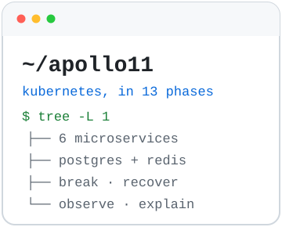
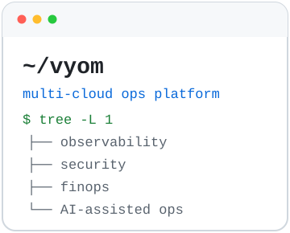
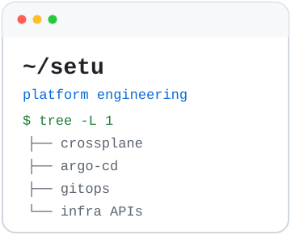
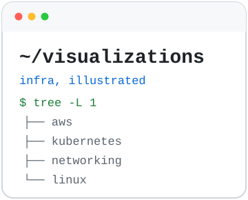

<p align="center">
  <picture><source media="(prefers-color-scheme: dark)" srcset="./assets/terminal.svg" /><source media="(prefers-color-scheme: light)" srcset="./assets/terminal-light.svg" /></picture>
</p>

<p align="center">
  <strong>Darshan Raul</strong> · Cloud Architect | AWS | Kubernetes | DevOps<br/>
  I design and run cloud platforms on AWS and Kubernetes, with a focus on availability,security and observability.
</p>

<p align="center">
  <a href="https://notes.darshanraul.me"></a>
  <a href="https://www.linkedin.com/in/darshanraul/"></a>
  <a href="https://x.com/280chardevops"></a>
</p>

<br/>

## `$ ls ~/projects`

<p align="center">
  <a href="https://github.com/darshan-raul/Apollo11"><picture><source media="(prefers-color-scheme: dark)" srcset="./assets/project-apollo11.svg" /><source media="(prefers-color-scheme: light)" srcset="./assets/project-apollo11-light.svg" /></picture></a>
  <a href="https://github.com/darshan-raul/vyom"><picture><source media="(prefers-color-scheme: dark)" srcset="./assets/project-vyom.svg" /><source media="(prefers-color-scheme: light)" srcset="./assets/project-vyom-light.svg" /></picture></a>
</p>
<p align="center">
  <a href="https://github.com/darshan-raul/setu"><picture><source media="(prefers-color-scheme: dark)" srcset="./assets/project-setu.svg" /><source media="(prefers-color-scheme: light)" srcset="./assets/project-setu-light.svg" /></picture></a>
  <a href="https://github.com/darshan-raul/visualizations"><picture><source media="(prefers-color-scheme: dark)" srcset="./assets/project-visualizations.svg" /><source media="(prefers-color-scheme: light)" srcset="./assets/project-visualizations-light.svg" /></picture></a>
</p>

- **[Apollo11](https://github.com/darshan-raul/Apollo11)**: a hands-on Kubernetes curriculum. Build, break and recover a flight booking platform across 13 phases.
- **[Vyom](https://github.com/darshan-raul/vyom)**: a multi-cloud ops platform covering observability, security, FinOps and AI-assisted operations.
- **[Setu](https://github.com/darshan-raul/setu)**: platform engineering with Crossplane, Argo CD and GitOps.
- **[Infra Illustrated](https://github.com/darshan-raul/visualizations)**: visual deep dives into AWS, Kubernetes, networking and Linux.

<br/>

## `$ cat stack.json`

<p align="center">
  <picture><source media="(prefers-color-scheme: dark)" srcset="./assets/stack.svg" /><source media="(prefers-color-scheme: light)" srcset="./assets/stack-light.svg" /></picture>
</p>

<br/>

## `$ kubectl get interests`

```text
NAME                     STATUS
aws                      Running
kubernetes               Running
platform-engineering     Running
observability            Running
security                 Running
distributed-systems      Running
ai-for-infrastructure    Running
```

<br/>

```bash
darshan@cloud:~$ echo "Automate the boring things. Understand the dangerous things."
```
