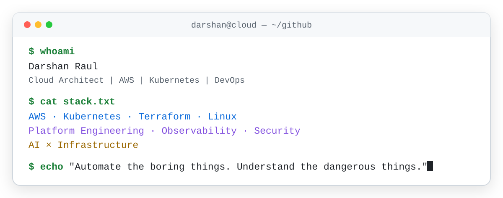
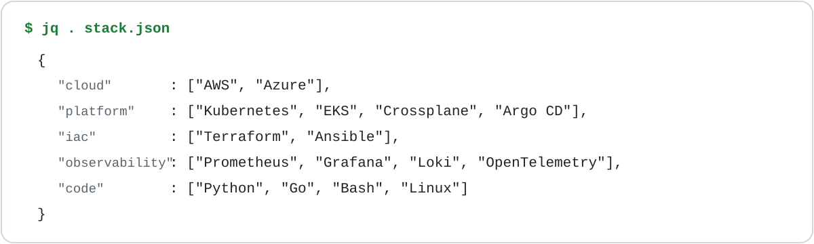

  <picture><source media="(prefers-color-scheme: dark)" srcset="./assets/terminal.svg" /><source media="(prefers-color-scheme: light)" srcset="./assets/terminal-light.svg" /></picture>

  <strong>Darshan Raul</strong> · Cloud Architect | AWS | Kubernetes | DevOps 
  I design and run cloud platforms on AWS and Kubernetes, with a focus on availability,security and observability.

  
  
  

 

## `$ cat stack.json`

  <picture><source media="(prefers-color-scheme: dark)" srcset="./assets/stack.svg" /><source media="(prefers-color-scheme: light)" srcset="./assets/stack-light.svg" /></picture>

 
